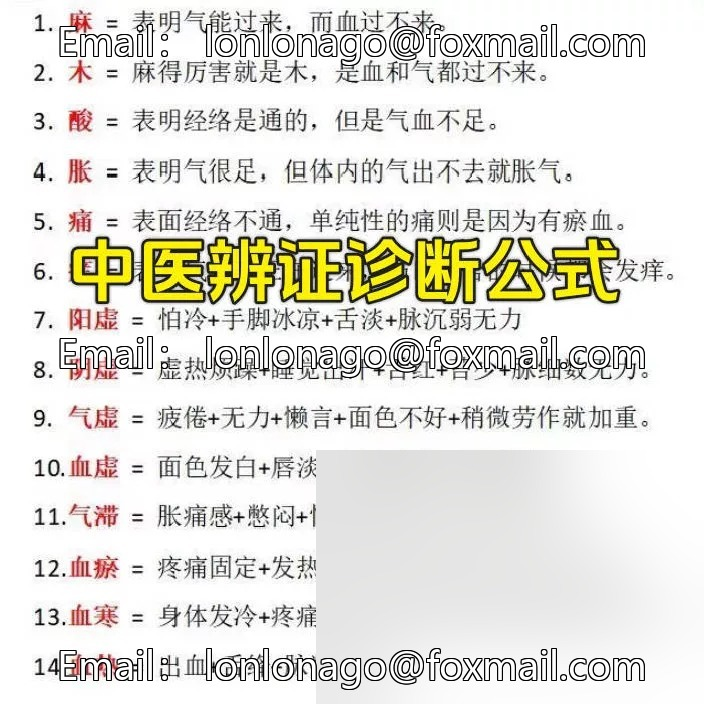
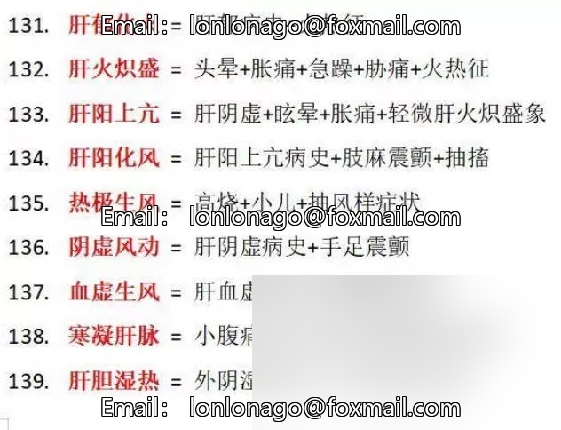

# Traditional Chinese syndrome differentiation diagnosis formula, 139.

## Body

Chinese diagnostic differentiation and diagnosis formula, 139 items.
word format (editable, printable)

web-based shipment, can be directly photographed and shipped.

There are 139 TCM syndrome diagnosis formulas, covering items such as Tai San Ma, Mu, Su, Zeng, Tong, Yang Wei, Yin Jiang, Qi Xu, Xue Xu, Qi Zhi, Xue Yue, Xue Han, Xue Re, Gan Lu Hua Huo, Gan Chi Shè, Gan Yang Shang, Gan Yang Hua Feng, Re Jie Sheng Feng, Yin Jiang Feng Dòng, Xue Xu Sheng Feng, Han Ning Gan Mai, Gan Ban Shí.

<!-- AI_ENRICHED -->

## Images

## Payment

Here is a pay link on Stripe ( https://buy.stripe.com/3cs8yP7sY87d0vu9AB ). Please contact me lonlonago@foxmail.com after funding $89, and I will send you a complete data files , thank you!

